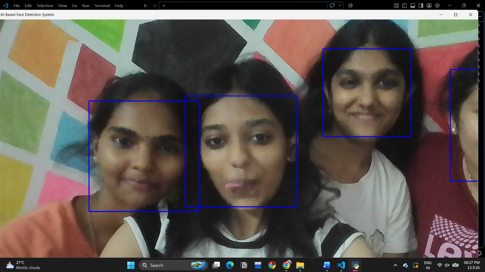
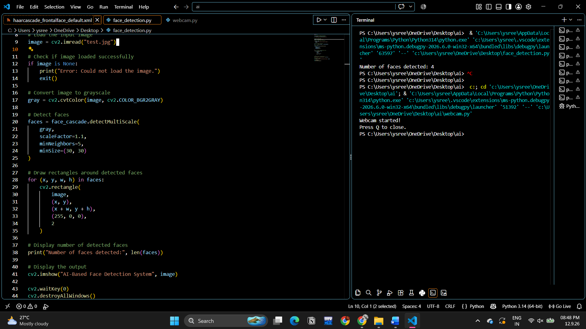
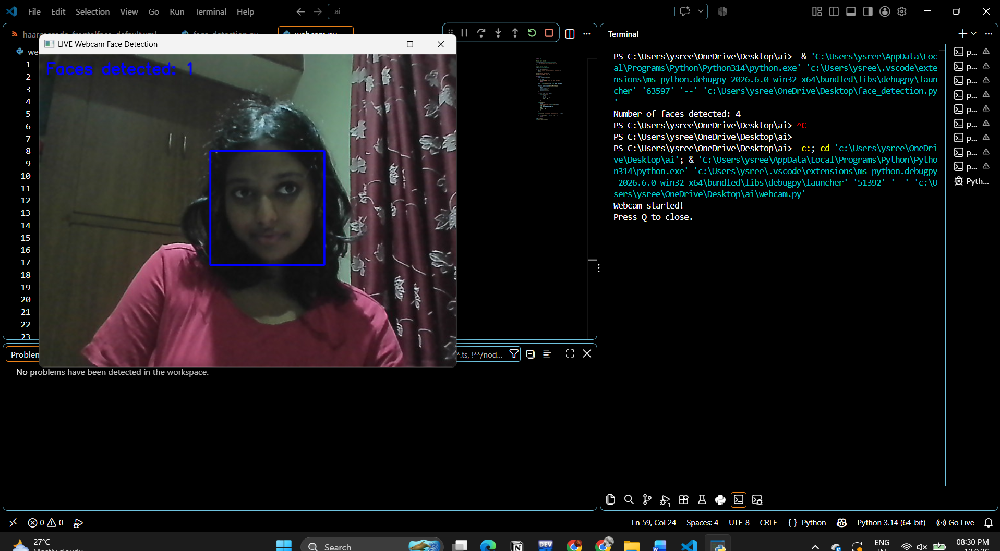

# Real-Time Face Detection Using OpenCV

## About the Project

This project demonstrates face detection using Python and OpenCV. It uses a Haar Cascade classifier to detect faces in images and through a live webcam feed.

The project includes three implementations:
- Single-face detection
- Multiple-face detection
- Real-time webcam face detection

It demonstrates how computer vision techniques can identify faces and highlight them using rectangular bounding boxes.

## Technologies Used

- Python
- OpenCV
- Haar Cascade Classifier

## Features

- Detect a single face in an image.
- Detect multiple faces in an image.
- Perform real-time face detection using a webcam.
- Highlight detected faces using rectangular bounding boxes.
- Process images using grayscale conversion.

## Project Structure

```text
real-time-face-detection/
│
├── README.md
├── requirements.txt
│
├── src/
│   ├── single_face_detection.py
│   ├── multiple_face_detection.py
│   ├── webcam_face_detection.py
│   └── haarcascade_frontalface_default.xml
│
├── screenshots/
│   ├── Screenshot1.png
│   ├── Screenshot2.png
│   ├── Screenshot3.png
│   └── Screenshot4.png
│
└── test_images/
    ├── test.jpg
    └── test2.jpg
```

## Project Demonstrations

### 1. Multiple-Face Detection

This demonstration shows face detection when multiple faces are present in an image.



### 2. Program Output

This screenshot shows an output from the face detection program.



### 3. Real-Time Webcam Face Detection

This demonstration shows face detection using a live webcam feed.



### 4. Single-Face Detection

This demonstration shows face detection for an image containing a single face.


## Test Images

The `test_images` folder contains the input images used to test the face detection programs.

- `test.jpg` — input image used for multiple-face detection.
- `test2.jpg` — input image used for single-face detection.

These images are separate from the output screenshots in the `screenshots` folder.

## Installation

### Prerequisites

- Python 3.x
- pip
- A webcam for real-time webcam detection

### Install Dependencies

Install the required OpenCV library:

```bash
pip install -r requirements.txt
```

The `requirements.txt` file should contain:

```text
opencv-python
```

## How to Run

Run the commands from the root directory of the repository.

### Single-Face Detection

```bash
python src/single_face_detection.py
```

### Multiple-Face Detection

```bash
python src/multiple_face_detection.py
```

### Webcam Face Detection

```bash
python src/webcam_face_detection.py
```

**Note:** The image-based programs require the appropriate test images. The webcam program requires webcam access. Ensure that the file paths in the Python programs match the repository structure.

## How It Works

1. The program loads the Haar Cascade face detection classifier.
2. The input image or webcam frame is read.
3. The image is converted to grayscale where required.
4. OpenCV's face detection function identifies potential faces.
5. Rectangular bounding boxes are drawn around the detected faces.
6. The resulting image or video frame is displayed.

## Learning Outcomes

Through this project, I explored:

- Image processing using OpenCV.
- Haar Cascade classifiers for face detection.
- Single-face and multiple-face detection.
- Real-time webcam processing.
- Drawing bounding boxes around detected faces.
- Organising Python source code and project resources in GitHub.

## Author

Computer Science Engineering Student
